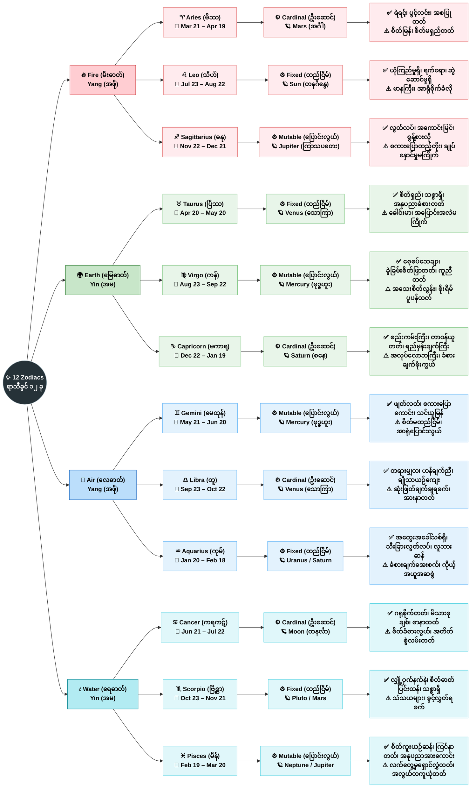
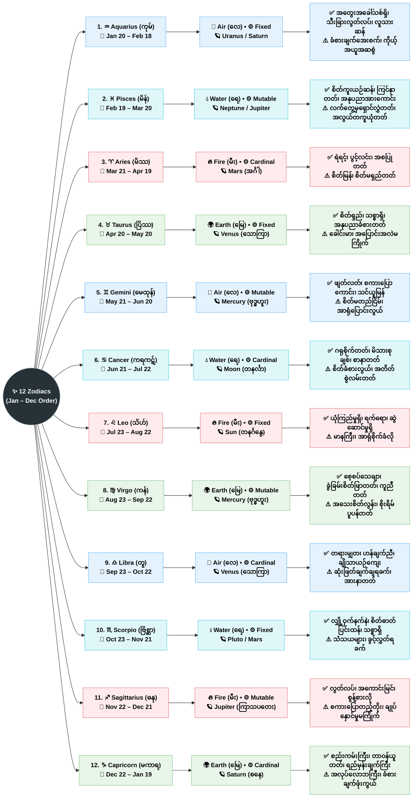

# ✨ 12 Zodiac Signs (ရာသီခွင် ၁၂ ခု)

* [1. Element Order (ဓာတ် ၄ ပါးအလိုက်)](#1-element-order-ဓာတ်-၄-ပါးအလိုက်)
* [2. Calendar Month Order (Jan – Dec အလိုက်)](#2-calendar-month-order-jan--dec-အလိုက်)

---

## 1. Element Order (ဓာတ် ၄ ပါးအလိုက်)

<strong>🔥🌍💨💧 ဓာတ်သဘောအလိုက် ကြည့်ရန် (Click to collapse)</strong>

---

## 2. Calendar Month Order (Jan – Dec အလိုက်)

<strong>📅 လအလိုက် အစဉ်အတိုင်း ကြည့်ရန် (Click to collapse)</strong>

