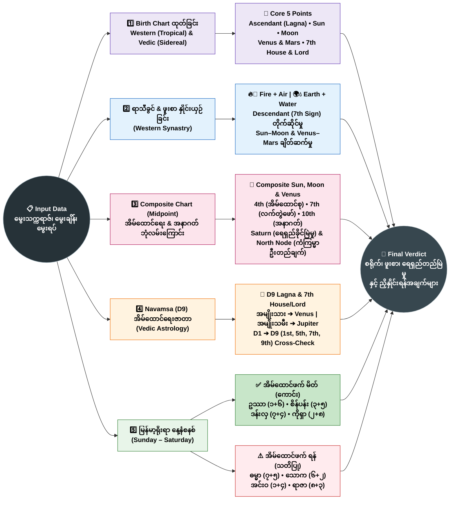

# 🔮 Astrology & Compatibility Analysis Workflow

## 1. Full Analysis Workflow (Mermaid Chart)

---

## 2. Western (Tropical) & Vedic (Sidereal) နှိုင်းယှဉ်ချက်

### စနစ် (၂) ခု ကွာခြားချက်
| စနစ် | အခြေခံတွက်ချက်မှု | အဓိက အသုံးပြုပုံ | 🔗 အခမဲ့ ထုတ်ကြည့်ရန် |
| :--- | :--- | :--- | :--- |
| **Western (Tropical)** | ရာသီဥတုနှင့် နေသွားလမ်းကြောင်း (Seasons) ကို အခြေခံ | စိတ်နေစိတ်ထား၊ စိတ်ပညာပိုင်းဆိုင်ရာ စရိုက်နှင့် အချစ်ရေး (Synastry) ကြည့်ရန် | [Astro-Seek (Western)](https://horoscopes.astro-seek.com/birth-chart-horoscope-online) |
| **Vedic (Sidereal)** | ကောင်းကင်ရှိ ကြယ်စုများ၏ အမှန်တကယ် တည်နေရာ (Lahiri Ayanamsa, ~24° ကွာ) | ဘဝဖြစ်စဉ်၊ ကံကြမ္မာအတက်အကျ (Dasha) နှင့် အိမ်ထောင်ရေးဇာတာ (Navamsa D9) ကြည့်ရန် | [Astro-Seek (Vedic)](https://horoscopes.astro-seek.com/sidereal-astrology-chart-calculator) • [VedicAstroChart](https://www.vedicastrochart.com/) |

### 🌟 Core 5 Points (မဖြစ်မနေ ဖတ်ရမည့် အချက် ၅ ချက်)
| အချက် | ကိုယ်စားပြုမှု |
| :--- | :--- |
| **Ascendant (Lagna)** | ပြင်ပစရိုက်၊ ဘဝဦးတည်ချက်နှင့် အိမ် (၁၂) အိမ်၏ အစ |
| **Sun Sign** | အတ္တ၊ ကိုယ်ရည်ကိုယ်သွေးနှင့် ရည်မှန်းချက် |
| **Moon Sign** | အတွင်းစိတ်ခံစားချက်၊ စိတ်လုံခြုံမှုနှင့် စိတ်ပိုင်းဆိုင်ရာ လိုအပ်ချက် |
| **Venus & Mars** | ချစ်ခြင်းမေတ္တာဖော်ပြပုံ (Venus) နှင့် ဆွဲဆောင်မှု/စိတ်လှုပ်ရှားမှု (Mars) |
| **7th House & Lord** | အိမ်ထောင်ဖက်၏ ပုံစံ၊ စရိုက်နှင့် ရေရှည်လက်တွဲဖော် ကံကြမ္မာ |

---

## 3. Western Synastry (ရာသီခွင်နှင့် ဖူးစာ နှိုင်းယှဉ်ချက်)

> 🔗 **တိုက်ရိုက်တွက်ကြည့်ရန်:** [Astro-Seek (Western Birth Chart & Synastry)](https://horoscopes.astro-seek.com/birth-chart-horoscope-online)

### ဓာတ်သဘော လိုက်ဖက်မှု (Element Harmony)
| ဓာတ်အတွဲ | လိုက်ဖက်မှု သဘာဝ |
| :--- | :--- |
| 🔥 **Fire + 💨 Air** | စိတ်ဓာတ်တက်ကြွမှုနှင့် အတွေးအခေါ်ချင်း အပေးအယူမျှပြီး တစ်ဦးကိုတစ်ဦး အားပေးနိုင် |
| 🌍 **Earth + 💧 Water** | လက်တွေ့ကျမှုနှင့် ခံစားချက်နွေးထွေးမှု ပေါင်းစပ်၍ ရေရှည်တည်ငြိမ်အေးချမ်း |
| **ဓာတ်တူချင်း (Same)** | နားလည်မှုမြန်သော်လည်း အားနည်းချက်တူသဖြင့် အပြန်အလှန် ညှိနှိုင်းရန်လို |

### အဓိက တိုက်ဆိုင်ရမည့် Synastry ချိတ်ဆက်မှုများ
| ချိတ်ဆက်မှု | အဓိပ္ပာယ် |
| :--- | :--- |
| **Descendant (7th Sign)** | မိမိ၏ ၇ တန့်အိမ်ရာသီသည် အခြားတစ်ဦး၏ Sun/Moon/Rising ဖြစ်နေပါက ဖူးစာဆုံနိုင်ခြေများ |
| **Sun – Moon** | တစ်ဦး၏ Sun နှင့် အခြားတစ်ဦး၏ Moon တစ်ရာသီတည်း (သို့) ဓာတ်တူကျပါက ရေရှည်အတွက် အကောင်းဆုံး |
| **Venus – Mars** | အချစ်ရေးဆွဲဆောင်မှု အားကောင်းပြီး ရိုမန်တစ်ဖြစ်မှုနှင့် စိတ်တူကိုယ်တူရှိမှုကို ပြ |

---

## 4. Composite Chart (အိမ်ထောင်ရေးနှင့် အနာဂတ် ဘုံလမ်းကြောင်း)

> 🔗 **တိုက်ရိုက်တွက်ကြည့်ရန်:** [Astro-Seek (Composite Chart)](https://horoscopes.astro-seek.com/composite-chart-horoscope) | [Astro-Charts (Composite)](https://astro-charts.com/tools/new/composite/)

နှစ်ဦး၏ မွေးဇာတာဂြိုဟ်များ၏ **Midpoints (အလယ်မှတ်)** များကို ပေါင်းစပ်၍ ဆက်ဆံရေးကိုယ်တိုင်၏ ဇာတာ (Relationship's Own Chart) အဖြစ် ဖတ်ရှုခြင်းဖြစ်သည်။

| စစ်ဆေးရမည့် အချက် | အဓိပ္ပာယ်နှင့် ဖတ်ရှုပုံ |
| :--- | :--- |
| **Composite Sun & Ascendant** | နှစ်ဦးပေါင်းစပ်မှု၏ အဓိကရည်မှန်းချက်နှင့် ပြင်ပလူအများမြင်သည့် စုံတွဲပုံရိပ် |
| **Composite Moon & Venus** | နှစ်ဦးကြား စိတ်ပိုင်းဆိုင်ရာ နွေးထွေးလုံခြုံမှု (Moon) နှင့် ချစ်ခြင်းမေတ္တာ ရေရှည်တည်တံ့မှု (Venus) |
| **Composite Saturn** | ရေရှည်ခိုင်မြဲမှု၊ တာဝန်ယူမှုနှင့် အိမ်ထောင်ရေးတွင် ရင်ဆိုင်ရမည့် စမ်းသပ်ချက်များ |
| **Composite North Node** | နှစ်ဦးအတူတကွ ဦးတည်လျှောက်လှမ်းရမည့် အနာဂတ် ဘုံလမ်းကြောင်းနှင့် ကံကြမ္မာရည်မှန်းချက် |
| **Key Houses (4th, 7th, 10th)** | **4th:** မိသားစုနှင့် အိမ်တွင်းရေး • **7th:** အိမ်ထောင်ရေးကတိကဝတ် • **10th:** ဘဝတိုးတက်မှုနှင့် လူမှုဂုဏ်သိက္ခာ |

---

## 5. Navamsa (D9) အိမ်ထောင်ရေးဇာတာ အညွှန်း

> 🔗 **တိုက်ရိုက်တွက်ကြည့်ရန်:** [Astro-Seek (Vedic Sidereal & Kundli)](https://horoscopes.astro-seek.com/sidereal-astrology-chart-calculator) | [VedicAstroChart](https://www.vedicastrochart.com/)

Vedic စနစ်တွင် **D1 (Rashi)** သည် အပင်ဖြစ်ပြီး **D9 (Navamsa)** သည် ထိုအပင်မှရမည့် အသီးအပွင့် (အိမ်ထောင်ပြုပြီးနောက်ပိုင်း ဘဝအမှန်) ဖြစ်သည်။

| စစ်ဆေးရမည့် အချက် | အဓိပ္ပာယ်နှင့် ဖတ်ရှုပုံ |
| :--- | :--- |
| **D9 Lagna & 7th House** | D1 တွင် ၇ တန့်အားနည်းသော်လည်း D9 တွင် အားကောင်းပါက အိမ်ထောင်ရေးသည် အချိန်ကြာလေ ခိုင်မြဲလေဖြစ် |
| **Karaka (ကိုယ်စားပြုဂြိုဟ်)** | **အမျိုးသားဇာတာ** ➔ D9 မှ **Venus** ကိုကြည့် / **အမျိုးသမီးဇာတာ** ➔ D9 မှ **Jupiter** ကိုကြည့် |
| **D1 ➔ D9 Cross-Check** | တစ်ဦး၏ D1 (Sun/Moon/Lagna) သည် အခြားတစ်ဦး၏ D9 မှ **1st, 5th, 7th, 9th** အိမ်များတွင် ကျပါက ရေရှည်ဖူးစာပါ |

---

## 6. မြန်မာ့ရိုးရာ နေ့နံ အိမ်ထောင်ဖက် တွဲဖက်မှု အညွှန်း

### ✅ အိမ်ထောင်ဖက် ကောင်း (ဥဿာ၊ စိန်ပန်း၊ ဒန်းလှ၊ ကိုရှာ)
| လင်္ကာ | နေ့နံအတွဲ | သဘာဝ |
| :--- | :--- | :--- |
| **ဥဿာ** | တနင်္ဂနွေ (၁) + သောကြာ (၆) | စီးပွားတိုးတက်၊ တစ်ဦးကိုတစ်ဦး အထောက်အပံ့ဖြစ် |
| **စိန်ပန်း** | အင်္ဂါ (၃) + ကြာသပတေး (၅) | သစ္စာရှိ၊ အကြံဉာဏ်နှင့် လက်တွေ့လုပ်ဆောင်မှု မျှတ |
| **ဒန်းလှ** | စနေ (၇) + ဗုဒ္ဓဟူး (၄) | စည်းကမ်းနှင့် ဉာဏ်ပညာပေါင်းစပ်၍ ရေရှည်တည်ငြိမ် |
| **ကိုရှာ** | တနင်္လာ (၂) + ရာဟု (၈) | စိတ်ချင်းနားလည်မှုရှိပြီး အပေးအယူမျှတ |

### ⚠️ အိမ်ထောင်ဖက် ရန် (ဓမ္မာ၊ သောက၊ အင်းဝ၊ ရာဇာ)
| လင်္ကာ | နေ့နံအတွဲ | သတိပြု ညှိနှိုင်းရန် |
| :--- | :--- | :--- |
| **ဓမ္မာ** | စနေ (၇) + ကြာသပတေး (၅) | အယူအဆနှင့် မာနချင်း ထိပ်တိုက်တွေ့တတ် |
| **သောက** | သောကြာ (၆) + တနင်္လာ (၂) | စိတ်ခံစားချက်နှင့် သံသယကြောင့် စိတ်ပူပန်ရတတ် |
| **အင်းဝ** | တနင်္ဂနွေ (၁) + ဗုဒ္ဓဟူး (၄) | စကားအပြောအဆိုနှင့် ဦးဆောင်လိုစိတ် ငြင်းခုံတတ် |
| **ရာဇာ** | ရာဟု (၈) + အင်္ဂါ (၃) | စိတ်မြန်ဒေါသကြီး၍ အချင်းချင်း သည်းခံမှုအားနည်းတတ် |
